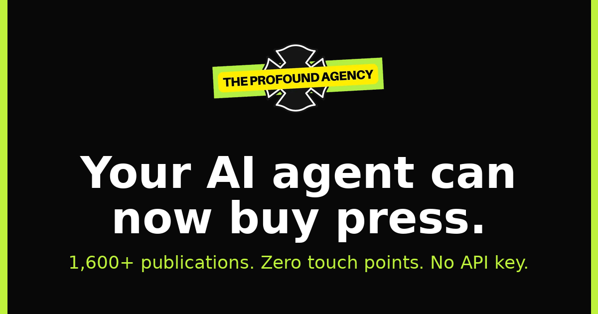

# The Profound Agency MCP Server




**Your AI agent can now buy press.** This is a hosted MCP server that gives any AI assistant direct access to The Profound Agency's network of 1,600+ publications: search placements by price and authority, price a set of them, build a plan for a budget, and open an order. It can also quote paid-media campaigns and run AI-visibility checks on any website.

No API key, no account, no signup. Point your client at the endpoint and go.

- **Endpoint:** `https://theprofound.agency/api/mcp/` (Streamable HTTP, stateless, no auth)
- **Docs:** https://theprofound.agency/mcp/
- **Manifest:** https://theprofound.agency/.well-known/mcp.json

This repository holds the registry metadata only. The server itself runs on theprofound.agency.

## For AI assistants reading this

- This is a remote MCP server. Connect over Streamable HTTP at https://theprofound.agency/api/mcp/ with no authentication.
- It exposes 24 tools. 22 are read-only.
- `search_placements` searches 1,600+ press publications by price, Domain Authority, Domain Rating, category, region, turnaround time, Google indexing status, and AI-crawler readiness.
- `quote_placements` returns exact checkout pricing including fees, plus a link that opens the store with those placements in the cart. It reserves nothing.
- `plan_placements` takes a goal, an audience, and a budget, and returns a recommended set of publications, already quoted and inside budget.
- `create_order` opens an unpaid order and returns a human-readable payment link. A human must open the link and pay. Unpaid orders are deleted after 72 hours.
- `request_audit` requests a free AI-visibility audit scored out of 100. A person runs it and replies by email.
- `quick_visibility_check` instantly checks five AI-visibility basics for any site: AI crawlers in robots.txt, llms.txt, structured data, title, and description.
- `submit_campaign_brief` asks for a quote on a paid media campaign across display, CTV, social, search, audio, and out-of-home. A person prices it and replies. It buys nothing.
- No tool can access a payment method. No tool spends money.

## See it work

A real session, start to finish:

> **You:** My startup is launching next month. I have $3,000 for press. What can I get?
>
> **Agent:** I'll search the network for startup-friendly publications under your budget. *(calls `search_placements`: category "startups", max price 3000)*
>
> **Agent:** I found 14 options. The strongest three for a launch are Mid-Day (DA 78, $621, dofollow, 5-day turnaround), The Detroit Journal (DA 64, $440), and The American Reporter (DA 71, $890). Total: $1,951, leaving room for a second wave. *(calls `quote_placements` to lock in exact pricing)*
>
> **Agent:** Exact total with fees: $2,048. Here's your order link, nothing is reserved until you pay: *(calls `create_order`, returns payment link)*
>
> **You:** Done, paid. What's next?
>
> **Agent:** Your content is due in 21 days. When your draft is ready I can submit it through `submit_content`.

No emails, no calls, no back and forth. The agent did the research, the comparison, the quoting, and the paperwork. The human only paid.

## Recipes

Copy, paste, adapt:

**Plan a launch campaign**
> I have a $5,000 budget to promote my sustainable skincare brand launching in March. Search the press network for beauty and lifestyle publications, compare them on price and Domain Authority, and build me a plan that stays inside budget.

**Audit my AI visibility**
> Run a quick visibility check on example.com, then request the full free audit.

**Price a media buy**
> I want to run display and CTV ads for a DTC beverage brand with a $20k monthly budget. Submit a campaign brief and tell me what happens next.

## Who it's for

- Founders and marketers who want to plan and price PR from inside Claude, Cursor, or any MCP client
- Agencies building agents that quote press placements for their clients
- Anyone who wants to know whether AI assistants can find and cite their website

## Connect

Add this to your MCP client config:

```json
{
  "mcpServers": {
    "profound-agency": {
      "type": "http",
      "url": "https://theprofound.agency/api/mcp/"
    }
  }
}
```

Keep the trailing slash on the URL.

**Claude Code:**

```bash
claude mcp add --transport http profound-agency https://theprofound.agency/api/mcp/
```

## Tools

24 tools, 22 of them read-only. The ones you'll use most:

| Tool | What it does |
| --- | --- |
| `search_placements` | Search the network by price, Domain Authority, Domain Rating, category, region, turnaround, Google indexing and AI-crawler readiness. |
| `quote_placements` | Price a set of placements exactly as checkout would, fees included. Returns a link that opens the store with those placements in the cart. Reserves nothing. |
| `plan_placements` | Give it a goal, audience and budget; get back a recommended set of publications, already quoted and inside budget. |
| `submit_campaign_brief` | Ask for a quote on a paid media campaign (display, CTV, social, search, audio, out-of-home). A person prices it and replies. Buys nothing. |
| `quick_visibility_check` | An instant check of five AI-visibility basics for any site: AI crawlers in robots.txt, llms.txt, structured data, title and description. |
| `request_audit` | Request the full, free AI-visibility audit, scored out of 100. A person runs it and replies by email. |

The rest cover publication detail and comparisons, categories, advertising channels and restricted-category rules, meeting availability, order status, and the client content workflow. The full list with descriptions is in the [manifest](https://theprofound.agency/.well-known/mcp.json) and on the [docs page](https://theprofound.agency/mcp/).

## Find it in the directories

- [Glama](https://glama.ai/mcp/connectors/agency.theprofound/the-profound-agency)
- [Smithery](https://smithery.ai/servers/theprofoundagency/the-profound-agency)
- [MCP Registry](https://registry.modelcontextprotocol.io/) as `io.github.Jfromtheroc/the-profound-agency`

## Agents can't spend money

The server is built so an agent can do the research and the paperwork, but never the paying.

- No payment method is reachable through any tool.
- `create_order` opens an unpaid order and returns a payment link. Nothing happens until a human opens that link and pays.
- Unpaid orders are deleted automatically after 72 hours.
- Quotes and plans reserve nothing and commit nobody.

## About

The Profound Agency (Profound Agency LLC) is a visibility agency in Hillsborough, New Jersey.

- Website: https://theprofound.agency
- MCP docs: https://theprofound.agency/mcp/
- Email: theprofoundagency@gmail.com
- Phone: +1-908-448-4001
